# Cupo, panel de administración del parqueadero

Panel web para administrar un parqueadero pequeño de 6 cupos de carro y 1 de moto. Desde aquí el administrador gestiona usuarios, revisa pagos, controla la puerta y consulta la analítica con pronóstico. Es el cliente del backend Spring Boot del proyecto ([Back_End_Parqueadero_App](https://github.com/dannygetcode/Back_End_Parqueadero_App)).


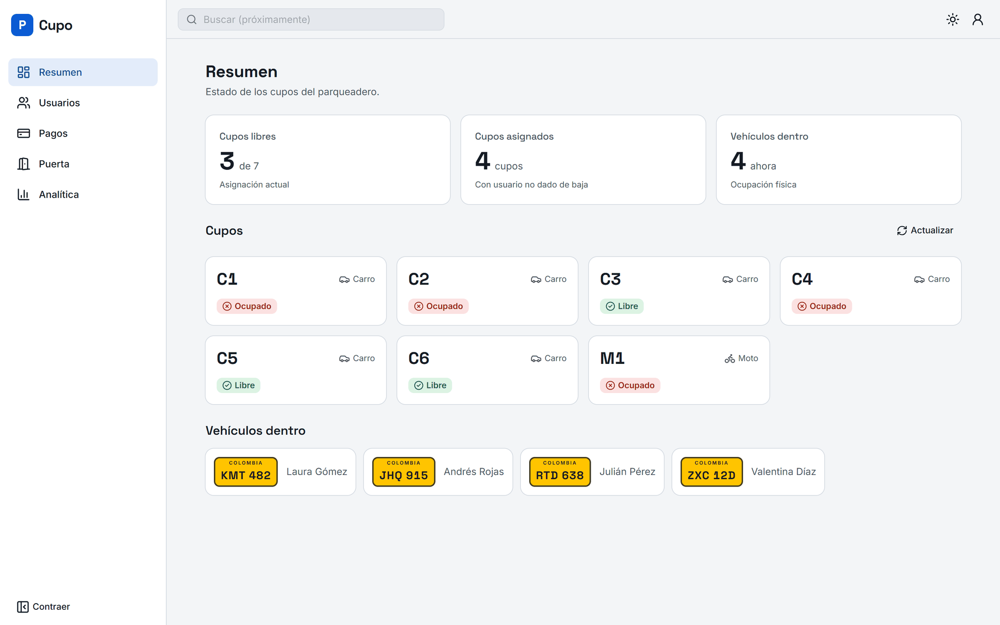

El panel nuevo vive en [`panel/`](panel/). El HTML y JavaScript plano de la raíz del repo (`index.html`, `dashboard/`, `js/`, `css/`) es el panel anterior. Apunta al contrato viejo del backend y no funciona; se conserva solo hasta que `panel/` lo reemplace por completo.

## Contenido

1. [Qué incluye](#qué-incluye)
2. [Arquitectura](#arquitectura)
3. [Diseño de la interfaz](#diseño-de-la-interfaz)
4. [Pantallas](#pantallas)
5. [Stack](#stack)
6. [Cómo correrlo](#cómo-correrlo)
7. [Contrato con el backend](#contrato-con-el-backend)
8. [Pendiente](#pendiente)

## Qué incluye

| Sección | Qué permite |
|---|---|
| Resumen | Estado de los 7 cupos y vehículos dentro en este momento |
| Usuarios | Alta con código de activación (se muestra una sola vez), edición, cambio de vehículo, suspensión y reactivación, baja y código nuevo |
| Pagos | Revisión de comprobantes con imagen, aprobar o rechazar, aviso de posible duplicado y registro de cortesías |
| Puerta | Persiana animada con cuenta regresiva, apertura y cierre manual, simulador de lectura de cámara e historial de accesos |
| Analítica | KPIs, ocupación por hora o día, mapa de calor, permanencia, ingresos, morosidad y pronóstico (cupo libre, ocupación esperada y hora de llegada) |

La analítica tiene un interruptor **Incluir datos simulados** que viene apagado, así nunca se confunden cifras reales con simuladas. El pronóstico siempre se muestra con su intervalo de incertidumbre y con las métricas de su backtest, y avisa cuando faltan datos.

## Arquitectura

### Backend for frontend

El navegador solo habla con Next.js y las llamadas al backend salen del servidor. El JWT del administrador vive en la cookie `cupo_session`, que es `httpOnly`, `SameSite=Strict`, `Secure` en producción y caduca con el token (4 horas). Ningún JavaScript del navegador puede leerla, y el token tampoco se guarda en `localStorage`.

Las pantallas piden datos a `/api/bff/<ruta>`. Ese proxy reenvía al backend, con `Authorization: Bearer`, solo las 30 rutas de una lista blanca (`panel/lib/server/backend.ts`); cualquier otra responde 404. Los métodos que modifican estado exigen un `Origin` igual al del panel. `proxy.ts` protege todas las rutas salvo el login, y `next.config.ts` agrega las cabeceras de seguridad (`Content-Security-Policy`, `X-Frame-Options`, `X-Content-Type-Options`, `Referrer-Policy`). No se usa `dangerouslySetInnerHTML` en ningún lugar.

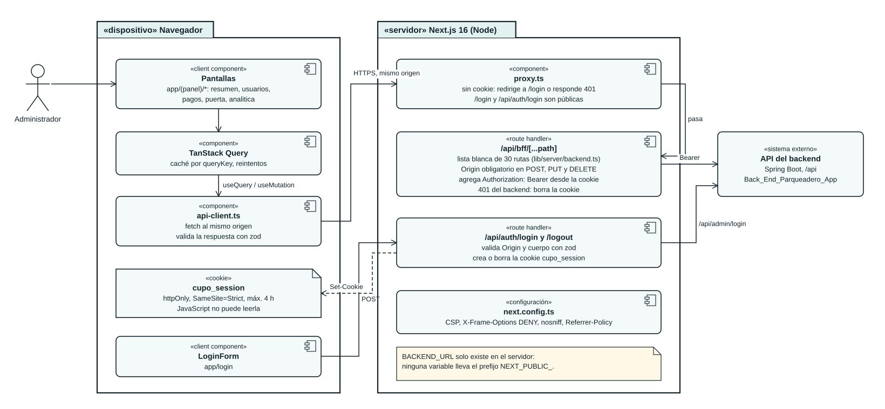

### Inicio de sesión y una petición

El formulario envía usuario y contraseña a `POST /api/auth/login`. Ese handler valida el cuerpo con zod, llama al backend y crea la cookie. Después, cada petición pasa por `proxy.ts` y por el BFF. Si el backend responde 401, el BFF borra la cookie y el cliente vuelve al login con un aviso. Los errores del backend llegan como `ProblemDetail` (RFC 9457) en español y se muestran tal cual.

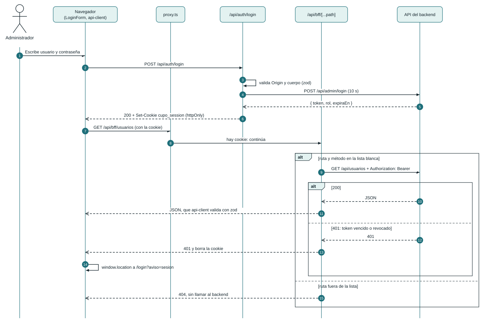

### Organización del código

El código del navegador y el del servidor están separados por carpeta. `lib/server/` solo se importa desde los route handlers, así el token y `BACKEND_URL` nunca terminan en el paquete que descarga el navegador. Todas las respuestas pasan por un schema de zod antes de llegar a una pantalla.

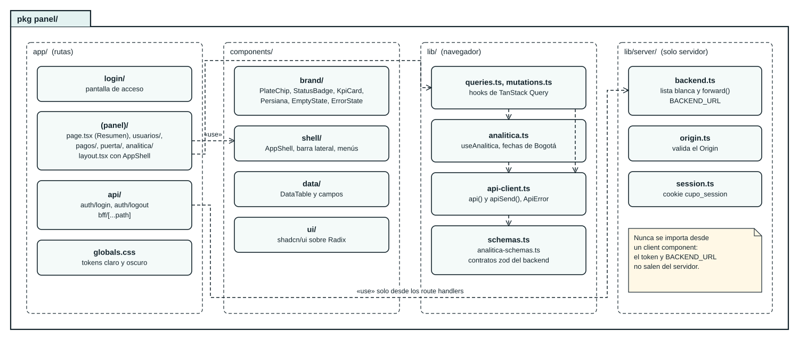

## Diseño de la interfaz

La marca Cupo toma el estilo de la señalética vial. El color primario es el azul de la señal P, y el amarillo de placa colombiana solo se usa como fondo con texto oscuro. Los estados llevan siempre icono y texto, nunca solo color. Títulos y cifras usan Space Grotesk, el cuerpo usa Inter, y montos y placas llevan cifras tabulares. Los tokens están en `panel/app/globals.css` y la interfaz está en español.

### Wireframes

Los wireframes muestran la estructura de las tres pantallas con más decisiones de diseño. Los números remiten a las anotaciones de la derecha.

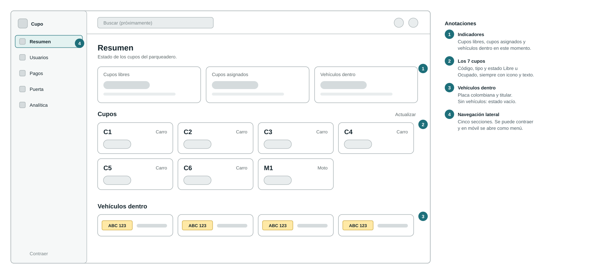

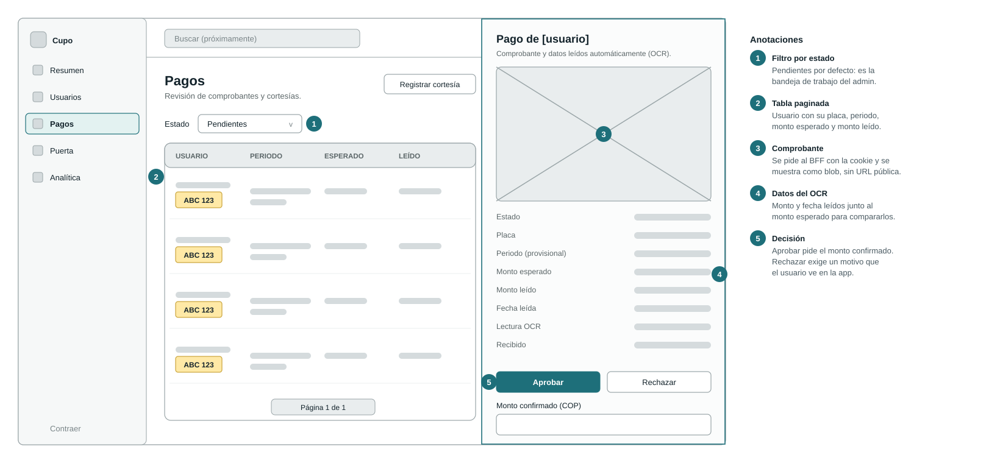

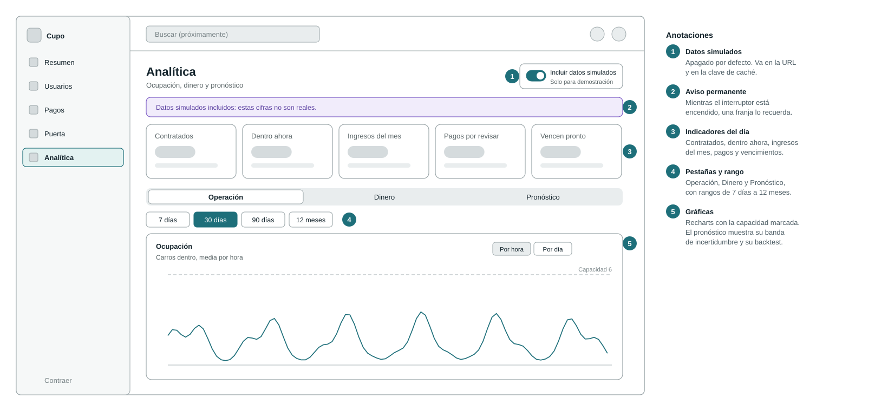

## Pantallas

Estas capturas son del panel real corriendo en local, con datos ficticios de demostración (usuarios, placas y comprobante inventados).

<table>
  <tr>
    <td width="50%">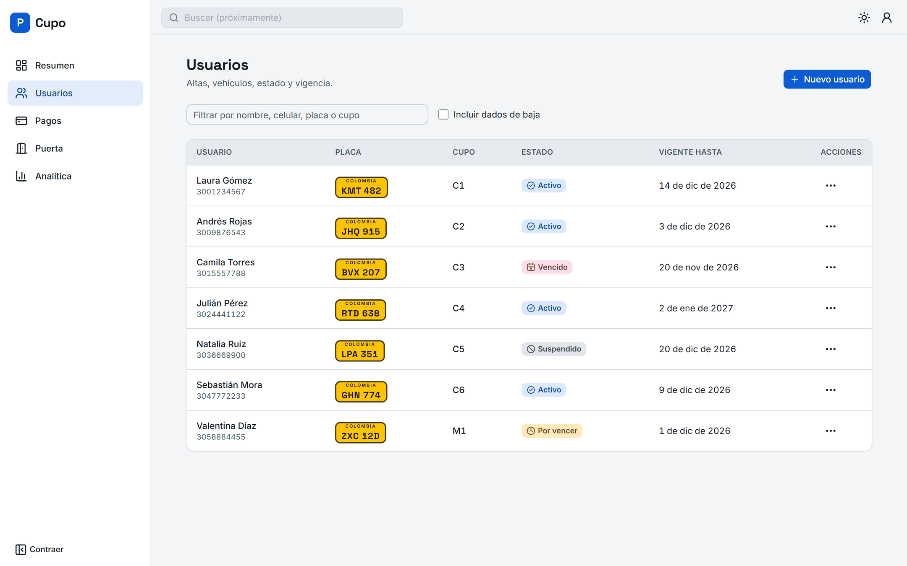<br/><sub><b>Usuarios.</b> Placa, cupo, estado y vigencia de cada titular.</sub></td>
    <td width="50%">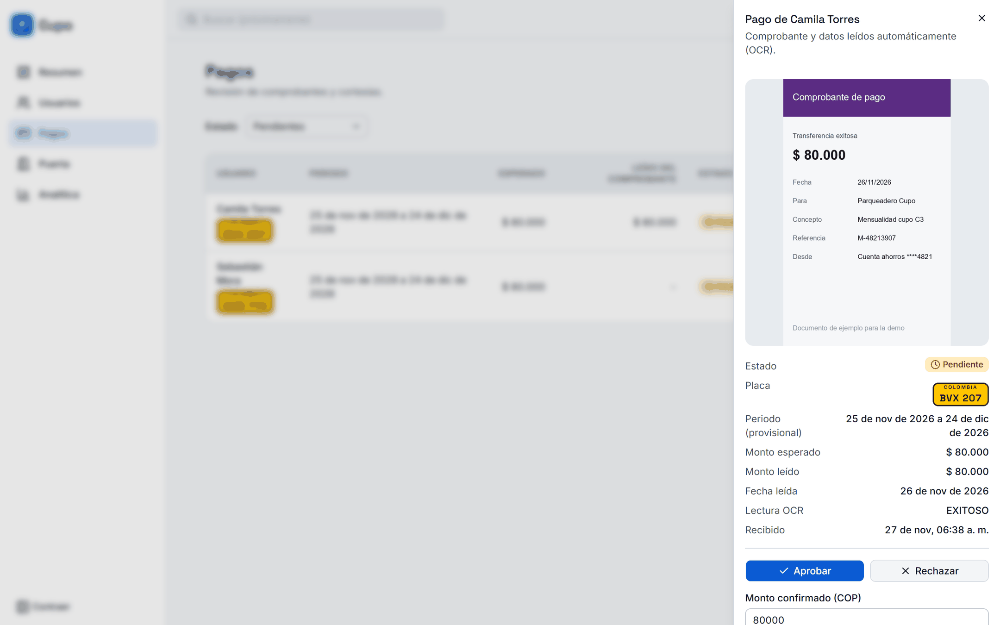<br/><sub><b>Revisión de un pago.</b> Comprobante, datos leídos por OCR y decisión.</sub></td>
  </tr>
  <tr>
    <td width="50%">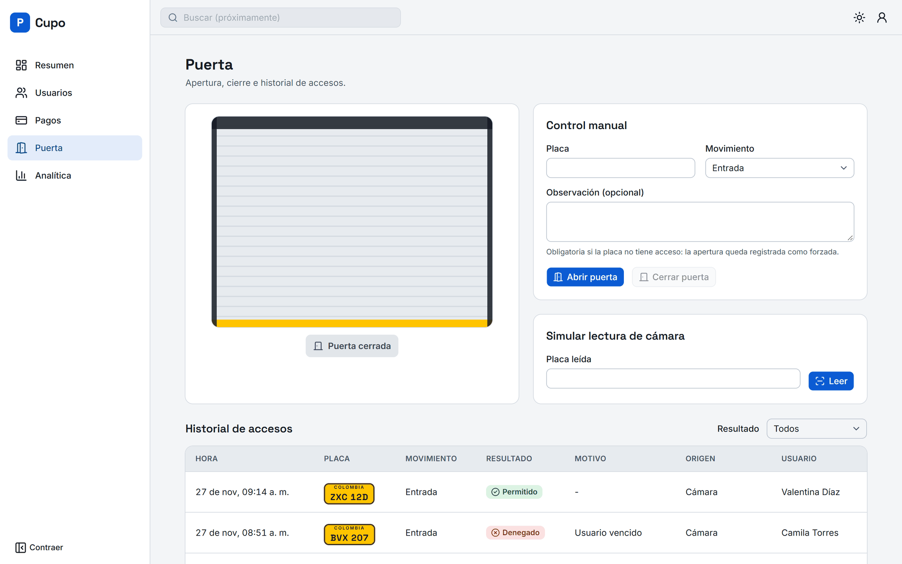<br/><sub><b>Puerta.</b> Persiana, control manual, simulador de cámara e historial.</sub></td>
    <td width="50%">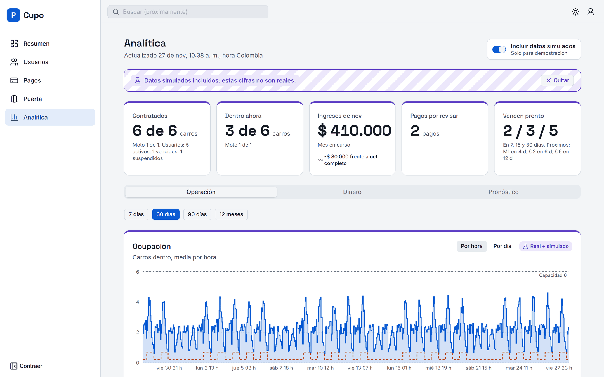<br/><sub><b>Analítica, operación.</b> Indicadores y ocupación por hora con la capacidad marcada.</sub></td>
  </tr>
  <tr>
    <td width="50%">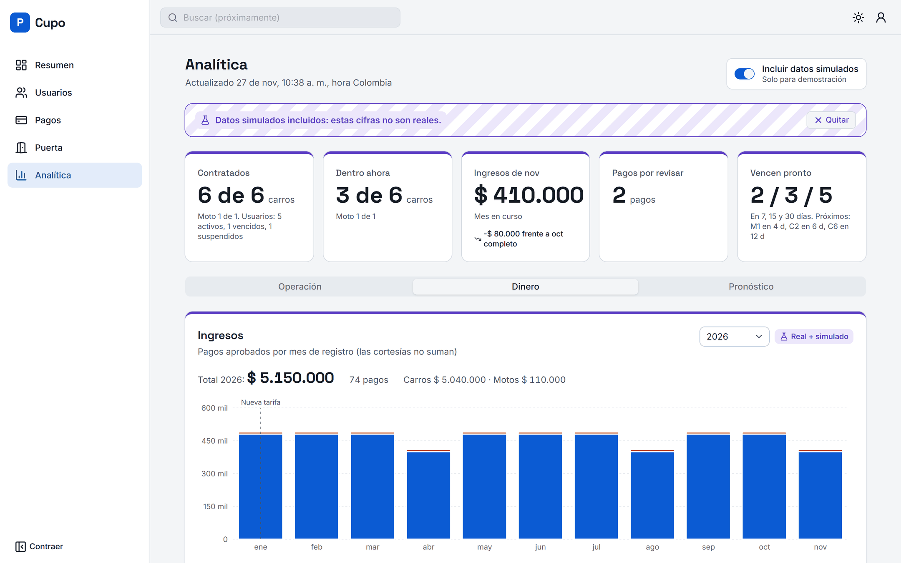<br/><sub><b>Analítica, dinero.</b> Ingresos por mes y cambio de tarifa.</sub></td>
    <td width="50%">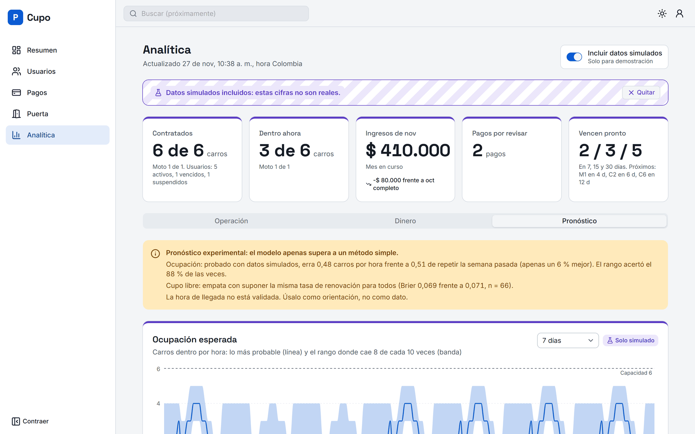<br/><sub><b>Analítica, pronóstico.</b> Aviso con las métricas del backtest y banda de incertidumbre.</sub></td>
  </tr>
  <tr>
    <td width="50%">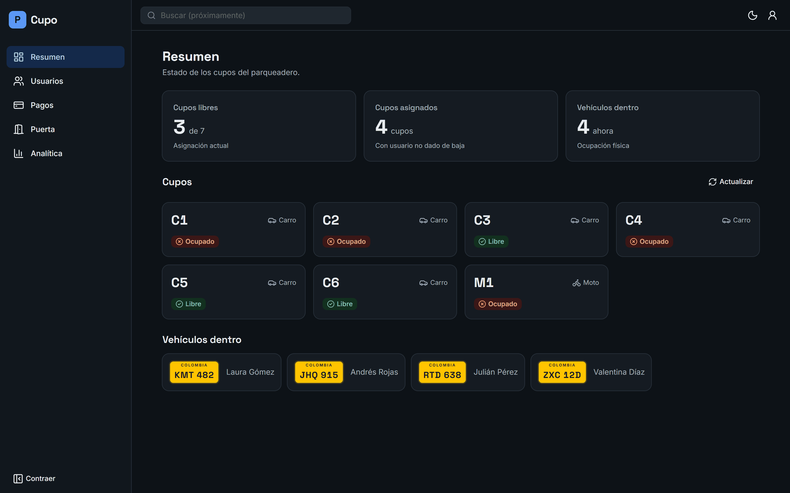<br/><sub><b>Tema oscuro.</b> Resumen.</sub></td>
    <td width="50%">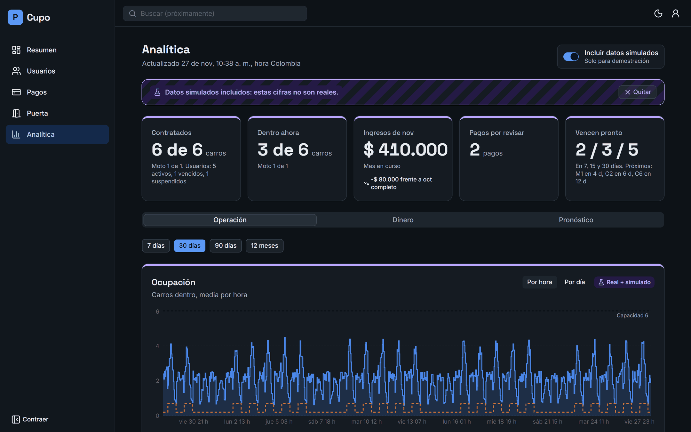<br/><sub><b>Tema oscuro.</b> Analítica con datos simulados.</sub></td>
  </tr>
  <tr>
    <td width="50%">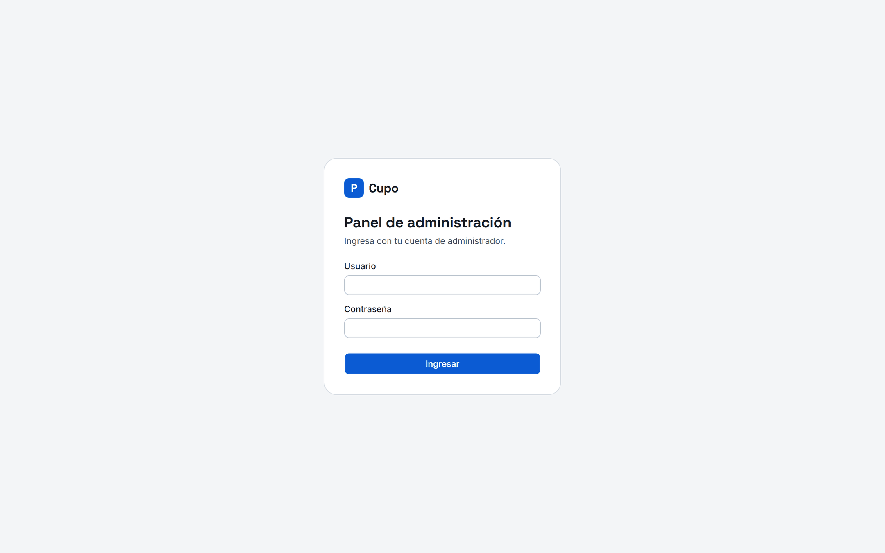<br/><sub><b>Inicio de sesión</b> del administrador.</sub></td>
    <td width="50%"></td>
  </tr>
</table>

## Stack

Next.js 16 con App Router, React 19, TypeScript estricto, Tailwind CSS v4, shadcn/ui sobre Radix y lucide-react. Los datos se manejan con TanStack Query y los formularios con react-hook-form y zod. Completan el stack next-themes (tema claro, oscuro o del sistema), sonner para los avisos y Recharts para las gráficas.

### Estructura de `panel/`

```
panel/
  app/
    login/              pantalla de acceso
    (panel)/            pantallas autenticadas: resumen, usuarios, pagos, puerta, analitica
    api/auth/           login y logout
    api/bff/[...path]/  proxy hacia el backend con lista blanca
    globals.css         tokens de diseño (variables CSS, claro y oscuro)
  components/
    brand/              PlateChip, StatusBadge, KpiCard, EmptyState, ErrorState, Persiana...
    data/               tabla base y campos de formulario
    shell/              barra lateral, barra superior y menús
    ui/                 componentes de shadcn/ui
  lib/
    server/             solo servidor: proxy con lista blanca y validación de Origin
    api-client.ts       cliente del navegador hacia el BFF
    schemas.ts          schemas zod de usuarios, pagos, puerta y formularios
    analitica*.ts       hooks, fechas de Bogotá, formato y schemas de analítica
  proxy.ts              protege todas las rutas salvo /login
```

## Cómo correrlo

Necesitas Node.js 20 o superior con npm, y el backend corriendo (por defecto en `http://127.0.0.1:8080`). Las credenciales del administrador son las que configura el backend en su `.env` (`ADMIN_USERNAME` y `ADMIN_PASSWORD`).

```bash
cd panel
cp .env.example .env.local     # ajusta BACKEND_URL si hace falta
npm install
npm run dev                    # http://localhost:3000
```

Para producción se compila y se sirve así.

```bash
npm run build
npm run start
```

Antes de subir cambios conviene correr estas tres verificaciones.

```bash
npm run build && npm run lint && npx tsc --noEmit
```

### Variables de entorno

Solo existen en el servidor. Ninguna lleva el prefijo `NEXT_PUBLIC_`, así que nunca llegan al navegador. Van en `panel/.env.local`, que Git ignora.

| Variable | Para qué sirve | Ejemplo |
|---|---|---|
| `BACKEND_URL` | URL del backend, sin barra final | `http://127.0.0.1:8080` |
| `ALLOWED_DEV_ORIGINS` | Solo desarrollo. IP o host de la red local desde la que abres el panel, separados por coma | `192.168.1.10` |

## Contrato con el backend

Los endpoints y DTOs están en el repositorio del backend, en `docs/arquitectura/fase-1-modelo.md` (sección 5) y `docs/cambios-de-contrato-fase-1.md`. La analítica y el pronóstico están en `docs/contrato-analitica.md`.

Para agregar una llamada nueva, añade la ruta a la lista blanca de `panel/lib/server/backend.ts`, define su schema en `panel/lib/schemas.ts` (o `panel/lib/analitica-schemas.ts`) y úsala con `api` o `apiSend` desde un `useQuery` o un `useMutation`.

## Pendiente

- Pantallas de Cámaras y Configuración (tarifas y cupos).
- Selector de fechas libre en Analítica. Hoy hay rangos fijos de 7 días a 12 meses.
- Pruebas automatizadas. Por ahora se verifica con build, lint, tsc y pruebas manuales.
- Retirar el panel anterior de la raíz del repo.
- Política de seguridad de contenido con nonce, en lugar de `unsafe-inline` en scripts.
